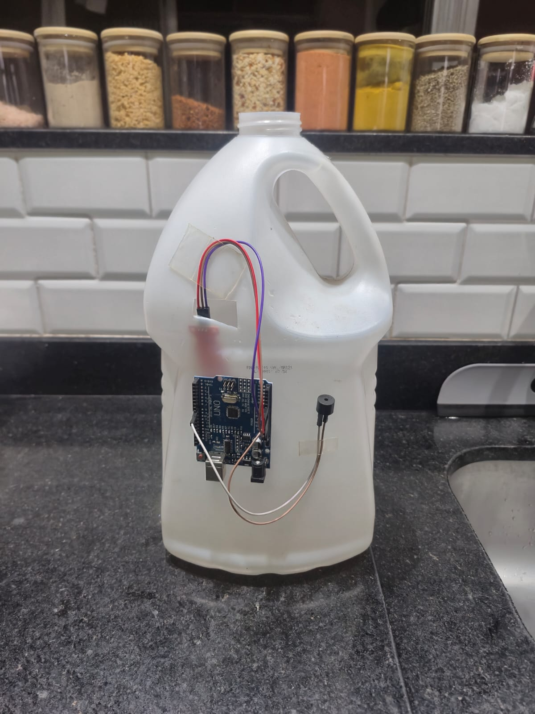
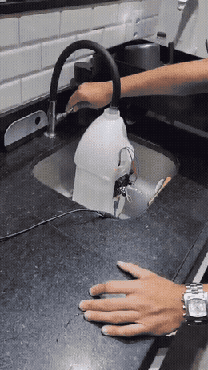

# Alarme de nível de água com Arduino

**Protótipo de alerta sonoro para evitar o transbordamento de um galão que armazena água de um aparelho de ar-condicionado.**

O sistema utiliza um **Arduino Uno**, um **sensor resistivo de detecção de água** e um **buzzer**. Quando a água atinge a região do sensor, instalada próxima ao nível máximo desejado, o Arduino identifica a leitura e aciona um aviso sonoro.

## Motivação: de um problema cotidiano a uma solução

A ideia surgiu de uma conversa com meu tio sobre uma dificuldade em seu apartamento. Como não era possível descartar na rua a água condensada pelo ar-condicionado, essa água era direcionada para dentro do apartamento e armazenada em um galão de aproximadamente **5 litros**.

O recipiente precisava ser esvaziado manualmente, mas, em algumas ocasiões, acabava sendo esquecido, fazendo com que a água transbordasse.

A partir dessa situação, surgiu a proposta de desenvolver um sistema simples e acessível que **avisasse, por meio de um sinal sonoro, quando o galão estivesse próximo de encher**, permitindo esvaziá-lo antes do transbordamento.

## Objetivo

Desenvolver e testar um protótipo capaz de:

- detectar quando a água alcança uma altura predefinida dentro do galão;
- acionar um alarme sonoro como aviso para esvaziar o recipiente;
- integrar sensor, microcontrolador e atuador em uma aplicação prática.

> **Observação:** o protótipo **não mede diretamente o volume de água em litros**. O aviso é determinado pelo posicionamento do sensor e pelo limite de leitura analógica configurado no programa.

## Demonstração do protótipo

**Registros do desenvolvimento:**

1. [Teste preliminar do sensor com um copo de água](media/teste-preliminar-copo.mp4)
2. [Montagem do sistema no galão](media/montagem-prototipo.mp4)
3. **[Ensaio de enchimento do galão — demonstração principal](media/ensaio-enchimento-galao.mp4)**

## Componentes utilizados

| Componente | Função |
| --- | --- |
| Arduino Uno | Lê o sensor e controla o alarme. |
| Sensor resistivo de água (placa vermelha, saída analógica) | Identifica contato da água com suas trilhas condutoras. |
| Buzzer | Emite o aviso sonoro. |
| Fios jumper | Realizam as conexões entre os componentes. |
| Galão plástico de aproximadamente 5 L | Armazena a água do ar-condicionado. |
| Cabo USB | Permite a programação e a alimentação durante os testes. |

### Ligações elétricas

| Componente | Terminal | Conexão no Arduino |
| --- | --- | --- |
| Sensor de água | `S` (sinal) | `A0` |
| Sensor de água | `+` | `5V` |
| Sensor de água | `−` | `GND` |
| Buzzer de baixa corrente, compatível com `tone()` | `+` | `D8` |
| Buzzer | `−` | `GND` |

Essas são as conexões de referência para o código disponibilizado. Verifique a identificação dos pinos do seu módulo antes de energizar o circuito. Para um buzzer com corrente superior à permitida pelo pino do Arduino, é necessário um estágio de acionamento adequado.

## Funcionamento

1. O sensor, ligado à entrada analógica **A0**, fornece uma leitura que varia de acordo com o contato com a água.
2. O Arduino executa `analogRead(A0)` e compara o resultado com o **limite de 500** definido no código desta versão.
3. Quando a leitura é **maior que 500**, o pino **D8** aciona o buzzer em **2.000 Hz**.
4. O alerta alterna **2 segundos de som** e **2 segundos de silêncio**. Ao final do ciclo, o código aguarda mais **200 ms** antes de reiniciar a leitura.
5. Quando uma nova leitura não ultrapassa o limite, o alarme é desligado.

O valor `500` é um **limiar de detecção**, não um volume ou uma porcentagem de enchimento. Ele pode precisar de ajuste conforme a água, o sensor e a montagem.

**Código do projeto:** [`codigo/projeto_alarme_agua.ino`](codigo/projeto_alarme_agua.ino). O arquivo corresponde à versão utilizada na demonstração e foi mantido sem alterações.

## Desafio de montagem: posicionamento do sensor

Uma das principais dificuldades encontradas durante a implementação foi definir **onde instalar o sensor no galão**.

Uma possibilidade seria introduzi-lo pela boca do recipiente. Entretanto, o cano do ar-condicionado despeja água por essa região; assim, as gotas poderiam atingir diretamente o sensor e **disparar o alarme antes que o nível da água estivesse realmente alto**.

Para contornar esse problema, foi feita uma **pequena abertura lateral (“janela”) no galão**. Essa adaptação permitiu posicionar o sensor **verticalmente**, próximo à altura desejada e **afastado do ponto onde as gotas caem**.

Com isso, buscou-se fazer com que a detecção dependesse da **elevação da água acumulada no recipiente**, e não dos respingos ou das gotas vindas do cano.

Esse ajuste mostrou que o desenvolvimento do sistema não dependia apenas do código: o **posicionamento mecânico do sensor** também era fundamental para o funcionamento esperado.

> Como evolução da montagem, a abertura lateral e as conexões devem receber proteção adequada, de forma a reduzir riscos de vazamento, respingos e contato da eletrônica com água.

## Como reproduzir o projeto

1. Com o Arduino desconectado da alimentação, confira as ligações da tabela acima.
2. Abra o arquivo [`codigo/projeto_alarme_agua.ino`](codigo/projeto_alarme_agua.ino) na **Arduino IDE**.
3. Selecione o modelo correto da placa e a porta de comunicação.
4. Compile e envie o programa ao Arduino.
5. Abra o **Monitor Serial** configurado em **9600 baud**.
6. Observe a leitura com o sensor seco e depois em contato com água, molhando apenas a região sensível.
7. Ajuste o valor de `limite` caso as leituras obtidas indiquem necessidade de calibração.
8. Posicione o sensor na altura desejada dentro do galão, afastado do fluxo direto de gotas, e repita o ensaio de enchimento.

## Testes e resultados

O desenvolvimento foi registrado em três etapas: **teste inicial do sensor**, **montagem no galão** e **ensaio com enchimento do recipiente**. Os vídeos acima documentam essas etapas e apresentam a demonstração do alarme.

A solução proposta permite um aviso de nível elevado por contato da água com o sensor instalado na altura escolhida. **Não foram documentadas neste repositório medições quantitativas de precisão, repetibilidade ou tempo de resposta**, portanto o protótipo deve ser entendido como uma prova de conceito, e não como dispositivo de segurança certificado.

## Limitações e melhorias futuras

- **Calibração:** registrar leituras em condições secas e molhadas para justificar o valor de disparo e reduzir alarmes indevidos.
- **Corrosão:** avaliar a durabilidade do sensor resistivo em contato com água; para uso prolongado, considerar uma **chave de boia** ou outra solução de nível.
- **Tempo de resposta:** substituir esperas com `delay()` por lógica baseada em `millis()`, permitindo ler o sensor enquanto o alarme soa.
- **Robustez da montagem:** proteger o Arduino, o buzzer, os conectores e a abertura lateral contra respingos ou vazamentos.
- **Tratamento do sinal:** implementar filtragem e histerese para evitar oscilações do alarme próximas ao nível de acionamento.

## Segurança

Os componentes eletrônicos e suas conexões devem permanecer **fora da área de contato com água**. Mantenha a alimentação e as tomadas longe de possíveis vazamentos. Esta montagem é um protótipo didático e **não deve ser utilizada como única proteção contra transbordamento**.

---

**Contexto acadêmico:** projeto prático de aprendizagem desenvolvido durante a graduação em **Engenharia Elétrica na Universidade Federal Fluminense (UFF)**, a partir de uma necessidade real identificada em família.
